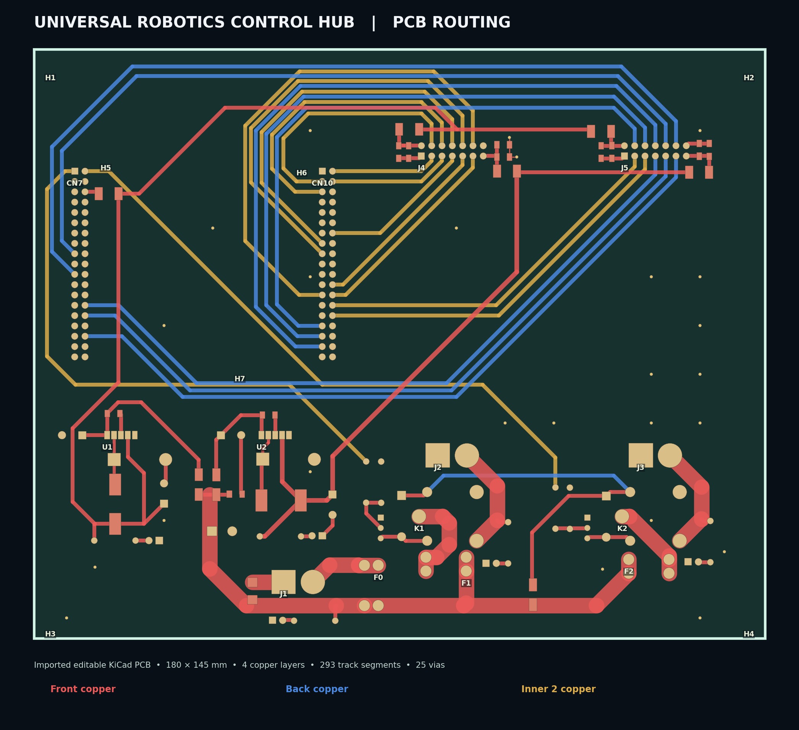

# Project information and specs

**Current source:** Uploaded native KiCad files, 22 November 2026. The files in `../KiCad/` are the current editable project; the files in `../Old Version/` are archived.

## What it is

A reusable STM32 robotics base board for attaching motor-driver or sensor modules. The design has two expansion headers, a 12 V input/power distribution system, two relay-switched 12 V branches, and 5 V and 3.3 V regulator stages. The separate motor-driver daughterboards are not part of this board.

## Specs visible in the latest PCB source

| Item | Saved design |
| --- | --- |
| PCB | 180 x 145 mm, declared 1.6 mm thick |
| Copper | 4 layers |
| Footprints | 68 |
| Track segments | 293 |
| Vias | 25 |
| Filled copper zones | 3 (GND) |
| Named nets seen in source review | 99 |
| PCB format | KiCad 10.0 |
| Main interface | STM32 Nucleo Morpho connectors |
| Module connections | Two 2x7 headers |
| Power sections | 12 V input and switching, 5 V and 3.3 V buck stages |
| Status | Editable source included, not electrically verified |

Earlier R4 documents describe 10 A targets per relay-switched output and other fuse/pin details, but those are **not measured ratings** and were **not revalidated for this final uploaded PCB**. Find those older documents in `../Old Version/hardware/rev4/` and `../Old Version/docs/`.

## Open and edit

Open `../KiCad/Unuversal robotic driver final versio.kicad_pro` in KiCad 10 (or a confirmed compatible version). Its matching schematic and PCB files live beside it. A `.kicad_prl` file is only local editor state and is not needed.

## Known problems and checks before manufacturing

- No fresh ERC (schematic) or DRC (PCB) result has been run on this uploaded revision.
- The schematic-to-PCB netlist match has not been verified in KiCad.
- A static geometry check found one **0.2 mm unassigned F.Cu segment outside the board outline**, near (-37.8, -51.4) to (-40.6, -51.4) mm. Inspect it in KiCad and remove/correct it.
- The PCB contains references to **20 separate local STEP/WRL 3D model filenames** that were not supplied. Footprint geometry is already embedded in the PCB, so the board and schematic remain editable; the 3D view may be incomplete.
- The separate `Carrier_Custom` footprint library was not supplied.
- No verified fabrication files (Gerbers and drills), full checked BOM, physical prototype, or continuous-current/temperature tests are available.

## Next checks

1. Run schematic ERC.
2. Run PCB DRC and check all unconnected nets and copper clearances.
3. Use **Update PCB from Schematic** to compare netlists, reviewing changes before applying them.
4. Check all pin mappings, power paths, relay ratings, and regulator parts.
5. Repair 3D model references if you need a full 3D view.
6. Export fabrication files only after these checks pass and test with a current-limited supply.

The included image is a preview generated from saved PCB routing data, not a photo of a manufactured PCB.
