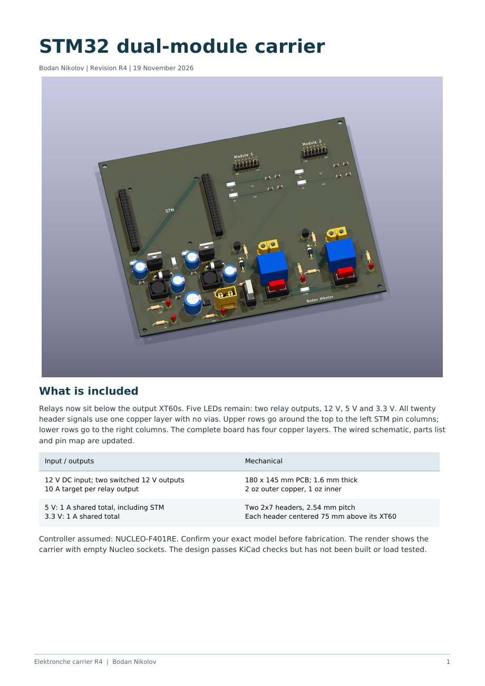
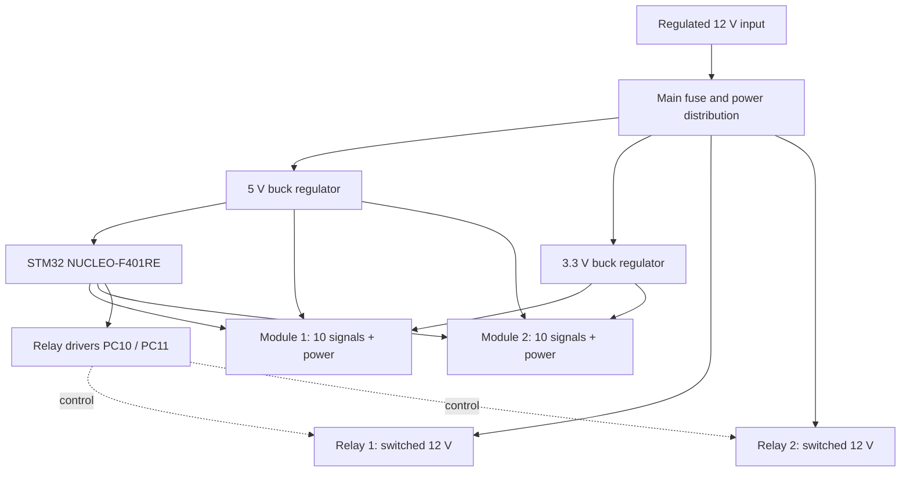

# Universal Robotics Control Hub

**Reusable STM32-based controller for robots, motors, sensors and custom modules.**

Designed by **Bodan Nikolov**, with project development and seminar work also carried out with **Dusan**. The aim is simple: spend less time fixing wires and rebuilding electronics, and more time building and programming the actual robot.

> **Status, 20 November 2026:** The latest documented carrier is **R4**, dated 19 November 2026. Its schematic and PCB passed the reported KiCad checks. **No fabricated or load-tested R4 board has been verified.** The documents are a design reference, not proof of safety or final motor-current ratings.

## The problem

When building a rover, robotic arm or another electronics project, motor drivers, voltage converters, connectors and power wiring take a lot of time. Prototype wires can loosen or break; breadboards and protoboards wear out. Making a custom PCB for every robot is slow and expensive. This project moves the common electronics onto a reusable base with modular connections.

## What the hub is meant to do

- Connect motor driver modules, servos, sensors and expansion boards without rebuilding all control wiring.
- Provide organized **12 V switched power**, **5 V** and **3.3 V** rails in the current R4 design.
- Use STM32 GPIO and PWM for motion control and digital outputs.
- Allow the same controller to be reused for different machines, from robotic arms and rovers to smart-home prototypes and test rigs.
- Support future custom motor-driver expansion boards and more onboard functions.

**Important distinction:** The original ambitious feature list (several integrated DC/BLDC/stepper drivers and 7.5-24 V input) is a *goal from early planning*. The current **R4 carrier** has two module connections and switched 12 V outputs; it does **not** implement all those motor drivers on the PCB. See [design history](docs/DESIGN_HISTORY.md).

## Current R4 hardware at a glance

| Item | Documented design |
| --- | --- |
| Main controller | STM32 **NUCLEO-F401RE assumed**, verify board revision |
| Input | **Regulated 12 V DC only** |
| Switched outputs | 2 relay-switched 12 V outputs, **10 A target each, untested** |
| Expansion | 2 × 2x7-pin headers, 10 GPIO/PWM signals per header |
| Signals | 20 total signal pins, up to 19 independent duty-cycle channels with timer limitations |
| Logic | 3.3 V GPIO; not automatically 5 V tolerant |
| Regulated rails | 5 V / 1 A shared, 3.3 V / 1 A shared |
| PCB | 180 x 145 mm, 1.6 mm thick, 4 copper layers; 2 oz outer / 1 oz inner |
| Indicator LEDs | 12 V, 5 V, 3.3 V, Relay 1, Relay 2 |
| Validation | Reported ERC 0, DRC 0; **no physical testing** |

## System overview

## What is in this repository

| Location | Contents |
| --- | --- |
| [`docs/`](docs/) | Goals, specifications, pin map, architecture, BOM, research method, test plan, safety, roadmap and history |
| [`hardware/rev4/`](hardware/rev4/) | R4 schematic PDF, illustrated technical guide and notes on missing editable files |
| [`hardware/relay-revA/`](hardware/relay-revA/) | Earlier relay prototype document, a **different** design from R4 |
| [`hardware/legacy-kicad/`](hardware/legacy-kicad/) | **Editable legacy KiCad PCB, schematic and project**, copied from the earlier Petnica repository |
| [`hardware/routing-history/`](hardware/routing-history/) | First routing work versus the improved R4 layout, with clear version notes |
| [`firmware/`](firmware/) | Starting point for an STM32 relay-control example (not a finished firmware project) |
| [`presentations/`](presentations/) | Earlier project + PLECS presentation, includes related DC-load material |
| [`assets/`](assets/) | R4 board render, R4 signal routing diagram and earlier PCB layout illustration |
| [`PUBLISH_TO_GITHUB.ps1`](PUBLISH_TO_GITHUB.ps1) | Windows script for uploading this folder to a new blank GitHub repo |

## Project applications

A single hardware platform can be adapted to a **robotic arm**, **rover**, **tracked robot**, **motor-control experiment**, **custom sensor system** or **smart-home controller**. The exact motors and sensors depend on the fitted expansion boards and power limits.

## Development approach

The project has included architecture planning, KiCad circuit and PCB work, STM32 pin assignment, relay/power design, and BLDC motor-control simulation in PLECS (including six-step, sinusoidal and FOC/PI concepts). Simulations are learning and design tools; they do not replace measurements on real hardware.

See [Project status](docs/PROJECT_STATUS.md) and [testing plan](docs/TEST_PLAN.md).

## Getting started

1. Read [the latest R4 hardware guide](hardware/rev4/Elektronche_Carrier_Guide.pdf) and [pin map](docs/PIN_MAP.md).
2. Do not connect motors or apply high current until the physical power stage is assembled, checked and tested using a current-limited supply.
3. For editable older KiCad work, open the [archived legacy KiCad files](hardware/legacy-kicad/README.md) and see [routing history](hardware/routing-history/README.md).
4. If publishing a **new GitHub repository**, create an empty repo named `Universal-Robotics-Control-Hub` under `bodanmakerpro-max`, then use `PUBLISH_TO_GITHUB.ps1` or the Git commands in [PUBLISHING.md](PUBLISHING.md).

## Note about licensing

No open-source license has been selected. Until one is added, do not assume that the hardware files or written content are available for unrestricted reuse.