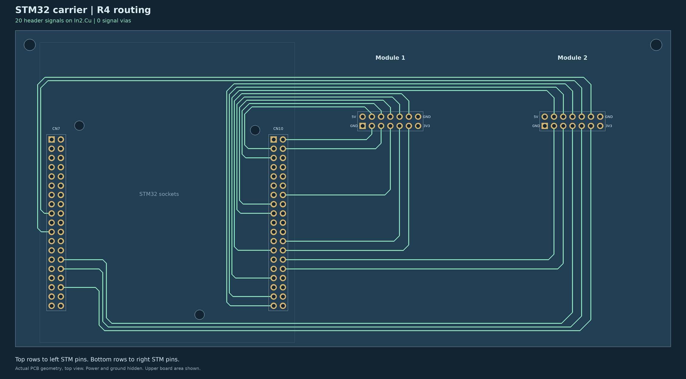

# Routing versions and improvements

This folder keeps the board-routing history separate from the latest released design references. The aim is to show how the wiring and signal routing improved, without mixing different board revisions.

## First / earlier stage

- An older hand-routed KiCad version was discussed as `Elektronche_Carrier_R3 bodan routing.kicad_pcb` (along with its project file). **The original two editable files were not available to the repository importer** at the time of upload. Do not treat the unrelated older reference image as that R3 PCB.
- An earlier Petnica Universal Robotics Driver KiCad project is preserved in [`../legacy-kicad/petnica_proekt_urd/`](../legacy-kicad/petnica_proekt_urd/). This is another older design, **not** the missing user-edited R3 PCB.
- The historical illustration [`../../assets/early_pcb_routing_reference.png`](../../assets/early_pcb_routing_reference.png) is only an early PCB layout reference, not a routing comparison of the R3 and R4 boards.

## Improved/current stage: R4, 19 November 2026

- **20 expansion-header signals routed on one signal layer without signal vias**, according to the R4 design report.
- Top connector pins routed around the top of the board to the left STM32 header; bottom connector pins routed to the right STM32 header.
- R4 uses four copper layers overall. *One-layer signal routing* does not imply a single-layer PCB.
- Two switched 12 V relay outputs and separate 5 V/3.3 V regulated rails.
- See the [R4 guide](../rev4/Elektronche_Carrier_Guide.pdf) and [exported schematic](../rev4/Elektronche_Carrier_Schematic.pdf).

**Status:** The R4 routing drawing is a published design illustration, not proof of production success. The editable R4 KiCad source and the user's exact R3/R4 pair still need to be added to make an editable file-by-file routing comparison.